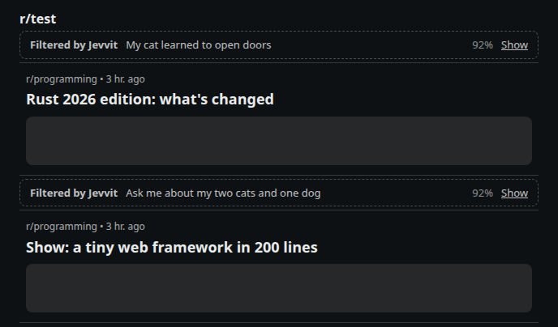
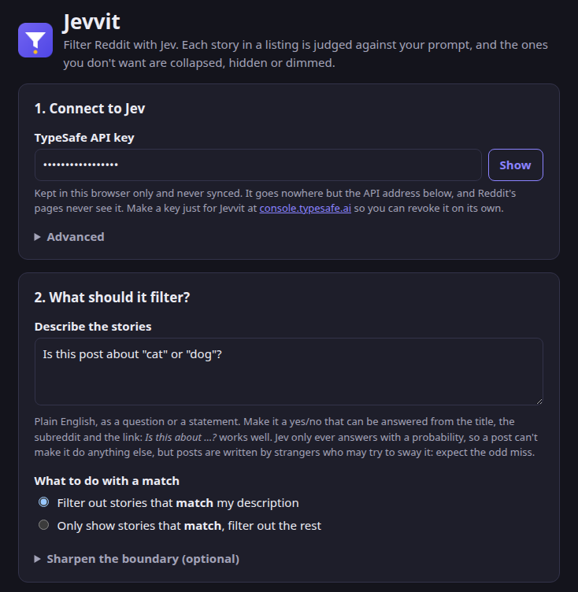

# Jevvit

**Filter Reddit with a fast, cheap AI.** Describe the stories you'd rather not see, in plain English. Jevvit
asks [Jev](https://docs.typesafe.ai/), TypeSafe's quick "System One" model, about each story in your feed, and
quietly collapses the ones that match.



A browser extension for Firefox and Chrome, built from one source tree.

> **Status: early (0.1).** The browser side is tested end to end in Firefox and Chrome, against a pretend Reddit
> built from real Reddit pages and a mock of the Jev API. Its requests to the real Jev API have been checked
> separately. It hasn't been tried on live Reddit yet, so expect rough edges there. It isn't in the add-on
> stores yet: install it from source (below).

## How it works

- Each story in a Reddit feed, on new Reddit or old Reddit, goes to Jev as a single yes/no question: your
  prompt. Jev answers with a probability.
- Two cutoffs that you set turn that probability into *filter*, *dim* or *leave alone*. Filtered stories are
  collapsed to one line you can click open (the default), hidden completely, or dimmed.
- Verdicts are remembered, so each story is judged once. Changing the cutoffs or the display re-applies at once
  without asking Jev again; changing the prompt asks again.
- It leaves alone the post whose comments you're reading, promoted posts (never sent at all), and any subreddits
  you exempt.
- It fails open. If Jev hasn't answered within 8 seconds, the story shows anyway. If the key is missing or
  rejected, stories show unfiltered and a notice on the page says why. If Jev can't be reached, they show
  unfiltered and the toolbar popup says what went wrong.
- The toolbar popup shows what happened on the current page (judged, filtered, dimmed, left alone), switches
  filtering on and off, and has *Show everything on this page*.

## Install

You'll need Firefox 140+ or Chrome 111+, [Node](https://nodejs.org/) 22 to build it (there are no npm packages
to install), and a TypeSafe API key from [console.typesafe.ai](https://console.typesafe.ai/settings/keys).

```sh
git clone https://github.com/coljac/jevvit.git
cd jevvit
node scripts/build.mjs        # writes build/firefox and build/chrome (or: just build)
```

### Firefox

Open `about:debugging#/runtime/this-firefox`, click **Load Temporary Add-on…** and choose
`build/firefox/manifest.json`. That lasts until Firefox restarts.

To keep it, it needs Mozilla's signature, because release Firefox only installs signed add-ons. Until Jevvit is
on addons.mozilla.org you can sign your own copy: run `node scripts/build.mjs --zip`, upload
`dist/jevvit-<version>-firefox.zip` at [addons.mozilla.org/developers](https://addons.mozilla.org/developers/),
and choose *On your own*. That signs it without listing it anywhere. Install the signed `.xpi` from the gear
menu in `about:addons`. Firefox Developer Edition and Nightly will also install an unsigned copy once
`xpinstall.signatures.required` is `false` in `about:config`.

### Chrome

Open `chrome://extensions`, switch on **Developer mode**, click **Load unpacked** and choose `build/chrome`.
Chrome keeps it and reads `build/chrome` afresh each time it starts. After rebuilding, press the reload arrow on
Jevvit's card.

## Set it up

The settings page opens by itself after installing (later, it's under the toolbar button).

1. Paste your TypeSafe API key. Make one just for Jevvit, so you can revoke it on its own.
2. Describe the stories, and choose whether to filter out the ones that match or show only the ones that match.
3. Try it: **Judge this story** checks one made-up or pasted story against your settings before you save.
4. Save, then browse Reddit.



Jevvit needs to read Reddit and to talk to the API. Firefox shows both permissions when you install it, and lets
you take them back in `about:addons` under Jevvit's *Permissions*. If either is missing, the settings page shows
a **Grant access** button.

## Writing the prompt

Jev answers **one yes/no question per story** with a probability, so phrase the prompt as something that is
true or false of a story:

- *Is this post about US politics?*
- *Is this a meme, joke or reaction image?*
- *Is this about a celebrity's private life?*

It sees the subreddit, title, flair, link domain, post type (link, image, video, gallery, text), the NSFW flag
and, if you allow it, the start of a text post's body. It doesn't see images, comments or the linked page, so ask
what can be answered from those.

Use the mode for direction rather than the wording. To see only astronomy, choose *Only show stories that match*
and ask *Is this about astronomy?*, not *Is this not about astronomy?*

If Jev gets the grey areas wrong, fill in **Sharpen the boundary**. Say what counts on each side, including the
case you'd have to think about yourself. For example:

- A match is: *Elections, parties, politicians, legislation, government decisions.*
- Not a match is: *Science, business or local news with no political angle, even if a government is mentioned.*

## How strict: the two cutoffs

Jev returns the probability that a story matches your description. In *filter out* mode:

| Jev's probability | What happens |
| --- | --- |
| at or above the filter cutoff (70% by default) | filtered: collapsed, hidden or dimmed |
| at or above the unsure cutoff (40% by default) | dimmed a little, back to normal on hover |
| below both | left alone |

In *only show matches* mode the same rule applies to the chance that a story *doesn't* match. Set the unsure
cutoff to 0 to switch dimming off. A collapsed story shows Jev's percentage; click it to bring the story back.

*Hidden completely* takes filtered stories off the page altogether. With a strict prompt that can make Reddit's
endless scrolling fetch page after page to fill the screen, which is why collapsing is the default.

## Privacy and your key

- **Sent to Jev for each story** (to `api.typesafe.ai`, or the API address you set): your prompt and criteria,
  plus the subreddit, title, flair, link domain, post type, NSFW flag and, if enabled, up to 600 characters
  (adjustable) of a text post's body. Never your username, votes, comments, cookies or anything else from your
  account. Promoted posts are never sent.
- **Your API key** is kept in the extension's local storage, in plain text inside your browser profile, and is
  never synced. Only Jevvit's background script sends it, and only to the API address. Reddit's pages never see
  it.
- **Remembered verdicts** stay in the same local storage for up to 30 days (4,000 at most), keyed by a hash of
  what was asked. *Clear remembered verdicts* on the settings page forgets them.
- The API address must be `https`, or plain `http` only for `localhost`, because the key travels with every
  request.
- Nothing is sent anywhere else, and nothing is collected about you.

## Cost

Jev bills input tokens only, about US$0.042 per million. In a test with a short prompt, each story came to about
320 input tokens, most of it a fixed overhead per request. So a thousand stories cost roughly 1.3 cents. A
text-post excerpt (about 150 tokens at the default 600 characters) and long criteria add to that. Remembered
verdicts cost nothing. Jevvit sends at most six requests at a time and backs off when the API asks it to.

## Known limits

- **Not yet tried on live Reddit.** Jevvit's picture of new Reddit's page comes from archived copies of real
  pages, and the end-to-end tests run against a pretend Reddit built from them. If the popup says *No stories
  recognised here yet* on a feed, Reddit's markup has drifted from what Jevvit expects; please open an issue.
- **Unverified:** where new Reddit puts a text post's body and flair in feeds (the archived pages had them
  empty), search results and user profile pages, and old Reddit (only a hand-made copy has been tested).
- **The real API from the browser.** Jevvit's request code has been run against the real Jev API, and its
  requests match the official TypeSafe SDK's exactly (a unit test compares them). In the browser, though, it has
  only met the mock API so far.
- **Posts are written by strangers.** Jev only ever answers with a probability, so a post can't make it do
  anything else, but a title can still be worded to slip past the filter or trip it. Expect the odd miss.

## Development

Node 22 runs everything; there are no dependencies. [`just`](https://github.com/casey/just) wraps the commands
(run `just` to list them), but each is a plain `node` script you can run directly.

| Command | What it does |
| --- | --- |
| `just test` | unit tests: core logic, API client, cache, build (about a second) |
| `just e2e` | end-to-end tests in headless Chrome and Firefox, e.g. `just e2e firefox --only feed,old --headed` |
| `just build`, `just zip` | write `build/firefox` and `build/chrome`; zip them into `dist/` |
| `just run`, `just stop` | start (or reload Jevvit in) a separate dev Firefox; close it |
| `just run-chrome` | start a separate dev Chrome (load `build/chrome` into it once, by hand) |
| `just mock` | a mock Jev API on `http://127.0.0.1:8787` |
| `just icons`, `just clean` | redraw the icons; delete build output and test profiles |

**The dev browser.** `just run` builds Jevvit and starts Firefox with its own profile under `.profiles/` and
Jevvit loaded. Run it again after a change to reload Jevvit. It's for development and trying things out, not
everyday browsing: while the dev Firefox runs, any program on your machine can connect to its debugging port
without being asked. That's how Jevvit gets loaded, the same way Mozilla's `web-ext` does it.

**Layout.** `src/` is the one Manifest V3 source for both browsers:

- `manifest.json`;
- `background.js`, the only part that holds the key and calls the API;
- `lib/core.js`, pure functions for the settings, the request and the cutoffs;
- `lib/client.js`, for requests, retries and the six-at-a-time pool;
- `lib/cache.js`;
- `content/`, which finds stories on new and old Reddit and applies the verdicts;
- `options/` and `popup/`.

`scripts/build.mjs` writes each browser's manifest (Firefox gets background scripts and an add-on ID, Chrome a
service worker) and checks that every file the build refers to exists.

**End-to-end tests.** Each run builds a test variant that may also talk to `127.0.0.1`, starts the mock API and a
pretend Reddit on random ports, and launches a throwaway browser profile: Chrome over a DevTools pipe, Firefox
over Marionette. It sets Jevvit up through its real settings page, then checks what happened to the pretend
Reddit and exactly what the mock was asked. It never touches real Reddit, the real API or your own profiles.
Screenshots land in `build/e2e/`.

**Trying it without a key.** Run `just mock`. Then, in Jevvit's settings, set the API address (under
*Advanced*) to `http://127.0.0.1:8787` and the key to `test-key-not-real`. The mock gives a story 0.92 if it
contains a word you quoted in the prompt (*Is this post about "election"?*), 0.55 if it contains `[maybe]`, and
0.05 otherwise. The browser will ask to let Jevvit reach `127.0.0.1`.

---

Jevvit isn't made by or affiliated with Reddit.
